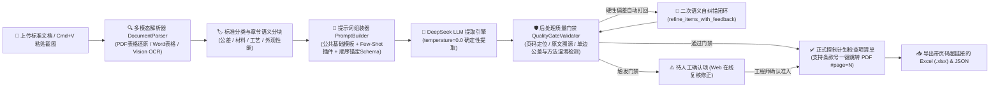

# CP-Extractor | 标准→控制计划检查项智能提取系统

**CP-Extractor** 是一套面向汽车行业质量工程师（IATF 16949）的智能辅助系统。系统通过 **“公共基础模板 + 四类专用插件 + 双层质量门禁校验 + 人工确认复核工作台”** 架构，将繁杂的技术标准（PDF、扫描件、Word、Markdown 或直接粘贴的标准截图）自动转化为结构化、可溯源、零编造的**控制计划（Control Plan）检查项清单**，并支持一键导出标准格式 Excel 报表。

---

## ✨ 核心特性

1. **📄 多格式解析、表格结构还原与长文档智能分块**
   - 支持直接上传 `.pdf`（含原生文本层及扫描件图片型 PDF）、`.docx`（自动保留并转换 Word 表格结构）、`.md`、`.txt`。
   - **PDF 表格对齐还原**：启用 `pypdf` 空间布局提取（`extraction_mode="layout"`），自动将多空格/制表符对齐的公差矩阵表与化学成分表转换为标准 Markdown 表格（`| 列1 | 列2 |`），防止跨列错行。
   - **长文档按章节语义分块**：针对多页大型标准文档，自动按章节标题与主条款边界切分上下文块（跨块自动继承文档标题与最新 PDF 页码标记），提取后自动合并去重，彻底消除单次输出 Token 截断与漏提。
   - **截图一键粘贴 (OCR)**：支持在网页端直接按 **`Cmd+V` / `Ctrl+V` 粘贴剪贴板截图**（或上传 `.png/.jpg/.webp`），内置 **macOS Apple Vision 高精度中英混合 OCR**（自动按行对齐表格）及 Tesseract 跨平台回退机制。
2. **🧩 模块化分类插件架构（深度融合 CTQ、GD&T 与 Few-Shot 正反例）**
   - 遵循 **Product CTQ（产品关键特性）** 与 **Process CTQ（过程关键特性）** 双维扫描体系，内置四大标准领域专用提取插件、**Few-Shot 黄金正反例**与 GD&T 符号库：
     - 📐 **公差/尺寸标准插件**（`tolerance` v1.2）：覆盖 ASME Y14.5 / ISO 1101 **全部 14 类 GD&T 几何特征控制框**（`⎯` `⏥` `⌯` `⌭` `⌒` `⌓` `⊥` `∥` `∠` `⌖` `◎` `≡` `↗` `⌕`）、单边公差原样保留（`+0.05/-0.00` 严禁改写为 `±0.05`）、括号参考尺寸 `(120)` 自动过滤及未注公差表逐行独立提取。
     - 🧪 **材料标准插件**（`material` v1.1）：聚焦化学成分（逐元素拆分）、拉伸/屈服/延伸率、硬度及金相，严格区分“试验方法”与“合格判据”。
     - 🔥 **工艺标准插件**（`process` v1.1）：聚焦热处理、焊接、涂装等过程参数窗口，严格区分并剔除“设备定期校验/维护要求”（如九点炉温测试），只提取在线“过程控制参数”。
     - ✨ **外观/性能标准插件**（`appearance_performance` v1.1）：聚焦表面缺陷限度、光源视距条件、盐雾耐候、附着力及定性描述转 `0 缺陷` 定量判据。
3. **🎯 顺序锚定防幻觉 & 二次语义自纠错闭环 (Self-Correction)**
   - **顺序锚定生成**：强制 LLM 在生成每个检查项 JSON 时，必须最先输出 `standard_clause`（标准条款号）与 `source_quote`（逐字原文引用）作为事实锚点，随后再推导公差规范、检查方法与判定准则。
   - **零温度确定性采样**：默认采用 `temperature=0.0` 贪婪解码，保障数值、正负号与 GD&T 符号最高保真度。
   - **门禁打回自动重提 (`refine_items_with_feedback`)**：当首次提取结果被后处理门禁检测出硬性偏差（如原文引用不匹配、单边公差被篡改为 `±`、试验方法与判定准则混淆）时，自动携带具体错误报告与原文本打回 LLM 进行定向自纠错并二次过检。
4. **🛡️ 双层质量门禁与反幻觉溯源（6 项硬性规则校验）**
   - **第一层（LLM 语义初判 + 模型强约束）**：对存疑或字迹模糊条款标记 `needs_human_review`，且所有低置信度项 100% 强制进入待人工确认清单。
   - **第二层（确定性规则门禁 `QualityGateValidator`）**：
     1. 标准条款号缺失拦截；
     2. 原文引用逐字溯源匹配（防大模型改写或编造）；
     3. 低置信度 100% 兜底拦截；
     4. 试验方法与判定准则语义混淆拦截；
     5. **CTQ 括号参考尺寸拦截**（如误提取 `(120)`、`(Ø62)` 等非受控参考尺寸自动拦截）；
     6. **CTQ 单边公差防篡改拦截**（如原文为 `+0.05/-0.00` 被改写为 `±0.05` 自动报警拦截）。
5. **🔗 条款号超链接一键跳转 PDF 对应页码 (`#page=N`)**
   - 自动根据分页标记与原文引用精确定位每条检查项所在的 PDF 页码（`source_page`）。
   - **Web 界面胶囊链接**：检查项清单与待审核卡片中的条款号自动渲染为可点击胶囊（如 **`📄 3.1 (P.1) ↗`**），点击后直接在新标签页打开原 PDF 并精准翻至对应页码。
   - **Excel 报表超链接同步**：导出的 `.xlsx` 控制计划报表中，「标准条款号」列同步写入 `条款号 (P.页码)` 及蓝色下划线 `#page=N` 超链接。
6. **🗂️ SQLite 多语言量检具/单位/判据校验词库 & 可视化配置工作台**
   - **独立 SQLite 多语种词库 (`data/lexicon.db`)**：内置 **126 组主词条（展开同义词后覆盖 526 个 🇨🇳中文 / 🇺🇸英文 / 🇯🇵日文 / 🇩🇪德文 / 🔣通用符号 专业术语）**，涵盖量检具与试验方法（`method`）、物理单位与 GD&T 符号（`unit`）、合格判据特征词（`criteria`）三大分类，实时作用于 `QualityGateValidator` 后处理门禁。
   - **Web 界面在线管理**：支持按中/英/日/德语种胶囊筛选、实时检索、批量新增/编辑多语言同义词对照及一键恢复出厂默认；同时内置提示词配置中心与人工确认门禁在线复核工作台。

---

## 🏗️ 系统工作流架构



---

## 📂 项目目录结构

```text
CP/
├── spec.md                         # 系统规格说明书 (v1.2 Living Spec，与代码双向契约绑定)
├── pyproject.toml                  # Python 项目依赖与构建配置
├── .env.example                    # 环境变量配置模板
├── start_lan.sh                    # 局域网共享一键启动脚本
├── templates/                      # 提示词模板与插件目录 (支持 Web 在线编辑)
│   ├── base_template.md            # 公共基础提取模板 (全局判定规则 + 顺序锚定 + Product/Process CTQ)
│   ├── validation_template.md      # 后处理校验与二次自纠错模板
│   ├── references/
│   │   └── gdt_symbols.md          # ASME Y14.5 / ISO 1101 14类 GD&T 几何特征符号标准参考库
│   └── plugins/                    # 四大类专用提取插件 (内置 Few-Shot 黄金正反例)
│       ├── tolerance.md            # 公差/尺寸标准插件 v1.2 (含 CTQ & GD&T 控制框规范)
│       ├── material.md             # 材料标准插件 v1.1
│       ├── process.md              # 工艺标准插件 v1.1
│       └── appearance_performance.md # 外观/性能标准插件 v1.1
├── scripts/
│   ├── vision_ocr.swift            # macOS 原生 Vision 框架高精度表格对齐 OCR 源码
│   └── run_benchmark.py            # 四类标准样本批量基准测试与产物导出脚本
├── src/
│   └── cp_extractor/
│       ├── api/
│       │   ├── app.py              # FastAPI 后端服务、REST 接口与源 PDF 在线预览服务
│       │   └── static/
│       │       └── index.html      # 可视化提取、提示词配置、条款跳转与人工复核前端工作台
│       ├── core/
│       │   ├── classifier.py       # 标准类别自动分类器
│       │   ├── extractor.py        # 核心提取流水线编排器 (支持章节语义分块、去重与二次自纠错)
│       │   ├── lexicon_db.py       # SQLite 多语言量检具/物理单位/判定准则校验词库管理器
│       │   ├── llm_client.py       # DeepSeek API 客户端 (零温度采样、顺序锚定与打回重提)
│       │   ├── mapper.py           # 控制计划 Excel (.xlsx) 报表导出映射器 (含 #page=N 超链接)
│       │   ├── parser.py           # 多格式文档、PDF 布局表格还原与截图 OCR 解析引擎
│       │   ├── prompt_builder.py   # 提示词组装、在线读写与默认还原管理器
│       │   └── validator.py        # 质量门禁、反幻觉溯源与 PDF 页码精确定位校验器
│       └── schemas/
│           └── models.py           # Pydantic V2 严格数据契约定义 (含 source_page & source_file_url)
└── tests/                          # 自动化单元测试、基准回归与 Spec 契约测试套件 (22 项全链路用例)
    ├── benchmark_samples/          # 四大类行业标准测试样本 (.md)
    ├── test_api_and_deepseek.py    # FastAPI 接口、人工审核闭环与提示词管理测试
    ├── test_benchmark_regression.py# 四类标准端到端回归测试
    ├── test_extractor.py           # 数据模型、表格还原、章节分块、自纠错与 PDF 超链接单元测试
    └── test_spec_consistency.py    # spec.md 与 Pydantic 模型/枚举/模板双向契约一致性测试
```

---

## 🚀 快速开始

### 1. 环境准备与依赖安装

要求 **Python >= 3.10**（推荐 Python 3.12）：

```bash
# 克隆仓库
git clone https://github.com/jxtanchris/cp-extractor.git
cd cp-extractor

# 创建虚拟环境并安装依赖
python3 -m venv .venv
source .venv/bin/activate
pip install -e ".[dev]"
```

### 2. 配置 DeepSeek API Key

方式一：复制环境变量模板并填入您的 API Key：
```bash
cp .env.example .env
```
编辑 `.env` 文件：
```env
DEEPSEEK_API_KEY=sk-您的真实密钥
DEEPSEEK_BASE_URL=https://api.deepseek.com
DEEPSEEK_MODEL=deepseek-chat
```

方式二：启动 Web 界面后，直接点击页面右上角 **「⚡ DeepSeek API 配置」** 在浏览器中填入保存。

### 3. 启动可视化 Web 工作台

- **局域网共享启动（推荐，本机与同一 Wi-Fi 下的同事均可直接访问）**：
  ```bash
  ./start_lan.sh
  ```
- **仅本机启动**：
  ```bash
  uvicorn src.cp_extractor.api.app:app --host 127.0.0.1 --port 8000 --reload
  ```

启动后打开浏览器访问：
- Web 工作台：**`http://localhost:8000`**
- Swagger 接口文档：**`http://localhost:8000/docs`**

---

## 🖥️ Web 工作台使用指南

1. **第一步：上传文档或粘贴截图**
   - 点击或拖拽上传 `.pdf`、`.docx`、`.md` 标准文档，或者直接使用截图快捷键截图后在页面按 **`Cmd+V` / `Ctrl+V`** 粘贴。
2. **第二步：选择标准所属类别 & 调整提示词规则**
   - 选择文档对应的标准类别（公差/尺寸、材料、工艺、外观/性能）。
   - 如需调整「待人工确认」的判定松紧度，点击顶部或第二步旁的 **「⚙️ 调整提示词/确认规则」**，可一键注入宽松/严格规则并实时保存生效。
3. **第三步：提取、条款页码溯源、人工门禁复核与导出**
   - 点击 **「🚀 开始提取检查项」**。
   - 在右侧查看「✅ 控制计划检查项清单」与「⚠️ 待人工确认项」：
     - 点击任意检查项的 **条款号胶囊链接（如 `📄 3.1 (P.1) ↗`）**，即可直接在新标签页打开原 PDF 并定位到对应页码核对原文；
     - 对待确认拦截项在线修订并点击确认准入或驳回后，点击右上角 **「📥 导出控制计划 Excel (.xlsx)」**（导出的 Excel 同样自带 PDF 页码跳转超链接）。

---

## 🧪 运行测试与基准验证

```bash
# 运行全部单元测试与回归测试
pytest -v

# 运行四大类标准基准测试并生成 Excel/JSON 样例至 output/ 目录
python scripts/run_benchmark.py
```
