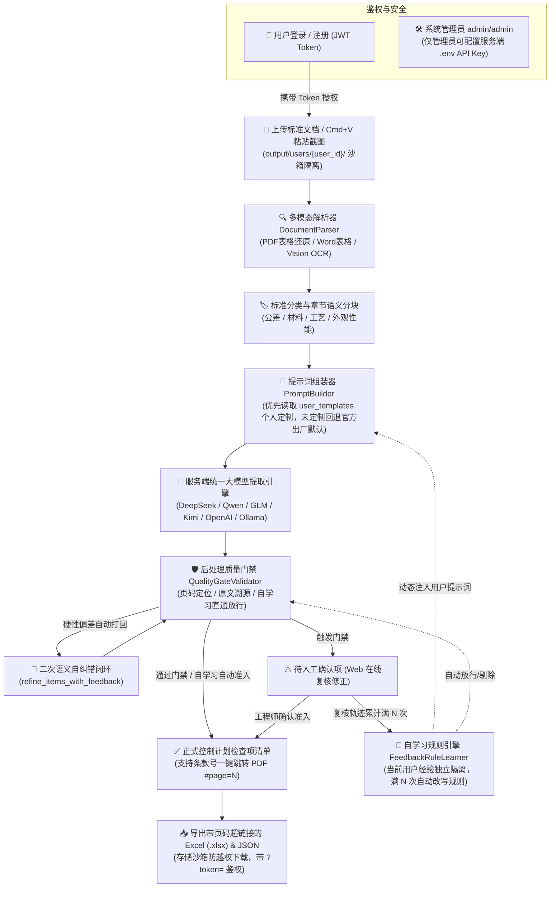

# CP-Extractor | 标准→控制计划检查项智能提取系统

**CP-Extractor** 是一套面向汽车行业质量工程师（IATF 16949）的智能辅助系统。系统通过 **“多租户隔离与安全沙箱 + 公共基础模板 + 四类专用插件 + 双层质量门禁校验 + 人工确认复核工作台”** 架构，将繁杂的技术标准（PDF、扫描件、Word、Markdown 或直接粘贴的标准截图）自动转化为结构化、可溯源、零编造的**控制计划（Control Plan）检查项清单**，并支持一键导出标准格式 Excel 报表。

---

## ✨ 核心特性

1. **🔐 工程师多租户认证体系与 API Key 集中安全管控**
   - **用户模型与 JWT 鉴权**：基于 SQLite (`data/app.db`)、PBKDF2-HMAC-SHA256 盐值密码散列与 RFC 7519 HS256 Token 鉴权，支持工程师独立注册与会话保持；系统核心操作（上传、提取、人工确认）**强制要求登录**（未登录 HTTP 401 拦截）。
   - **各用户密码自主安全修改**：已登录用户可在顶部随时点击 **「🔒 修改密码」**，经旧密码身份核验后自主更新密码；登录界面遵循安全隐私规范，不外显初始密码提示。
   - **管理员用户浏览与历史穿透审计**：系统管理员拥有专属管理面板（`GET /api/admin/users`），可实时浏览全量注册工程师账号、活跃状态与各自提取统计；支持一键穿透审计任意工程师的专属历史记录并调阅复核其解析成果。
   - **服务端全局 Key 集中管理**：严格遵循企业安全规范，普通工程师**禁止且无需配置个人 API Key**，统一使用服务端环境变量 `.env`；保护 `/api/llm/save-env` 接口，仅系统管理员允许修改（非管理员尝试修改返回 HTTP 403 Forbidden）。
   - **默认管理员开箱即用**：系统初始化内置管理员账号密码 **`admin` / `admin`**，具备跨租户文件审计与服务端模型配置特权。
2. **📦 提示词两级继承隔离架构 (System Default + User Override)**
   - **用户专属个性化微调**：工程师对公差、材料、工艺、外观提示词的微调覆盖保存在 `user_templates` 数据表中，仅对当前工程师生效，**绝对不污染磁盘官方模板文件**。
   - **系统出厂默认自动兜底**：工程师未定制时，自动无缝回退读取磁盘 `templates/*.md` 官方版本；支持在界面**单键恢复出厂默认**。
3. **🛡️ 文件存储沙箱隔离与防水平越权 (IDOR)**
   - **沙箱物理隔离**：用户上传的标准源文档与导出的 Excel/JSON 物理隔离存储在 **`output/users/{user_id}/`** 专属目录。
   - **水平越权 (IDOR) 强行拦截**：严禁通过 URL 或文件名跨租户窃取他人上传的涉密标准文档或导出报表，越权访问触发 HTTP 403 Forbidden 强行阻断；同时具备 Path Traversal 路径遍历攻击检测（`../` 自动拦截）。
   - **双通道无缝鉴权**：PDF 在线预览与 Excel 下载同时支持 `Authorization: Bearer` Header 与 URL 查询参数 `?token=...`，确保在新标签页浏览器直接翻阅 PDF（`#page=N`）时不被拦截。
4. **📁 个人专属解析历史记录管理 (`HistoryManager`)**
   - **自动化历史归档**：每次提取完成后，系统自动在 SQLite (`extraction_history`) 表中记录文档名称、识别类别、模式、使用模型、项数统计及对应沙箱产物下载地址。
   - **一键重载工作台 (One-Click Reload)**：工程师随时点击顶部 **「📁 历史记录」**，可一览个人所有历史提取记录；点击 **「👁️ 载入」** 即可瞬间将历史结构化结果完整还原至右侧审核面板，无需重新消耗大模型 Token 即可再次复核或导出；支持安全下载与一键删除。
5. **🧠 自学习规则多租户经验隔离与自动演进 (`FeedbackRuleLearner`)**
   - **复核轨迹独立观察**：系统按 `user_id` 物理隔离记录工程师在「⚠️ 待人工确认项」上的每一次手工决策（`✔️ 确认准入` 或 `✖️ 驳回剔除`），各工程师专业判断经验互不干扰混淆。
   - **满 $N$ 次自动改规则（三层联动）**：当同一项目被当前工程师累计手工准入（或驳回）达到设定阈值 $N$ 次（默认 `3` 次，支持 `1/2/3/5` 次或立即生效）后，自动放行/剔除、源头注入提示词并自动收录新量检具至 SQLite 词库。
5. **📄 多格式解析、表格结构还原与长文档智能分块**
   - 支持直接上传 `.pdf`（含原生文本层及扫描件图片型 PDF）、`.docx`（自动保留并转换 Word 表格结构）、`.md`、`.txt`。
   - **PDF 表格对齐还原**：启用 `pypdf` 空间布局提取（`extraction_mode="layout"`），自动将多空格/制表符对齐的公差矩阵表与化学成分表转换为标准 Markdown 表格（`| 列1 | 列2 |`），防止跨列错行。
   - **长文档按章节语义分块**：针对多页大型标准文档，自动按章节标题与主条款边界切分上下文块（跨块自动继承文档标题与最新 PDF 页码标记），提取后自动合并去重，彻底消除单次输出 Token 截断与漏提。
   - **截图一键粘贴 (OCR)**：支持在网页端直接按 **`Cmd+V` / `Ctrl+V` 粘贴剪贴板截图**（或上传 `.png/.jpg/.webp`），内置 **macOS Apple Vision 高精度中英混合 OCR**（自动按行对齐表格）及 Tesseract 跨平台回退机制。
6. **🧩 模块化分类插件架构（深度融合 CTQ、GD&T 与 Few-Shot 正反例）**
   - 遵循 **Product CTQ（产品关键特性）** 与 **Process CTQ（过程关键特性）** 双维扫描体系，内置四大标准领域专用提取插件、**Few-Shot 黄金正反例**与 GD&T 符号库：
     - 📐 **公差/尺寸标准插件**（`tolerance` v1.2）：覆盖 ASME Y14.5 / ISO 1101 **全部 14 类 GD&T 几何特征控制框**（`⎯` `⏥` `⌯` `⌭` `⌒` `⌓` `⊥` `∥` `∠` `⌖` `◎` `≡` `↗` `⌕`）、单边公差原样保留（`+0.05/-0.00` 严禁改写为 `±0.05`）、括号参考尺寸 `(120)` 自动过滤及未注公差表逐行独立提取。
     - 🧪 **材料标准插件**（`material` v1.1）：聚焦化学成分（逐元素拆分）、拉伸/屈服/延伸率、硬度及金相，严格区分“试验方法”与“合格判据”。
     - 🔥 **工艺标准插件**（`process` v1.1）：聚焦热处理、焊接、涂装等过程参数窗口，严格区分并剔除“设备定期校验/维护要求”（如九点炉温测试），只提取在线“过程控制参数”。
     - ✨ **外观/性能标准插件**（`appearance_performance` v1.1）：聚焦表面缺陷限度、光源视距条件、盐雾耐候、附着力及定性描述转 `0 缺陷` 定量判据。
7. **🎯 顺序锚定防幻觉 & 二次语义自纠错闭环 (Self-Correction)**
   - **顺序锚定生成**：强制 LLM 在生成每个检查项 JSON 时，必须最先输出 `standard_clause`（标准条款号）与 `source_quote`（逐字原文引用）作为事实锚点，随后再推导公差规范、检查方法与判定准则。
   - **零温度确定性采样**：默认采用 `temperature=0.0` 贪婪解码，保障数值、正负号与 GD&T 符号最高保真度。
   - **门禁打回自动重提 (`refine_items_with_feedback`)**：当首次提取结果被后处理门禁检测出硬性偏差（如原文引用不匹配、单边公差被篡改为 `±`、试验方法与判定准则混淆）时，自动携带具体错误报告与原文本打回 LLM 进行定向自纠错并二次过检。
8. **🛡️ 双层质量门禁与反幻觉溯源（6 项硬性规则校验）**
   - **第一层（LLM 语义初判 + 模型强约束）**：对存疑或字迹模糊条款标记 `needs_human_review`，且所有低置信度项 100% 强制进入待人工确认清单。
   - **第二层（确定性规则门禁 `QualityGateValidator`）**：
     1. 标准条款号缺失拦截；
     2. 原文引用逐字溯源匹配（防大模型改写或编造）；
     3. 低置信度 100% 兜底拦截；
     4. 试验方法与判定准则语义混淆拦截；
     5. **CTQ 括号参考尺寸拦截**（如误提取 `(120)`、`(Ø62)` 等非受控参考尺寸自动拦截）；
     6. **CTQ 单边公差防篡改拦截**（如原文为 `+0.05/-0.00` 被改写为 `±0.05` 自动报警拦截）。
9. **🔗 条款号超链接一键跳转 PDF 对应页码 (`#page=N`)**
   - 自动根据分页标记与原文引用精确定位每条检查项所在的 PDF 页码（`source_page`）。
   - **Web 界面胶囊链接**：检查项清单与待审核卡片中的条款号自动渲染为可点击胶囊（如 **`📄 3.1 (P.1) ↗`**），点击后直接在新标签页打开原 PDF 并精准翻至对应页码。
   - **Excel 报表超链接同步**：导出的 `.xlsx` 控制计划报表中，「标准条款号」列同步写入 `条款号 (P.页码)` 及蓝色下划线 `#page=N` 超链接。
10. **🗂️ SQLite 多语言量检具/单位/判据校验词库 & 可视化配置工作台**
    - **独立 SQLite 多语种词库 (`data/lexicon.db`)**：内置 **126 组主词条（展开同义词后覆盖 526 个 🇨🇳中文 / 🇺🇸英文 / 🇯🇵日文 / 🇩🇪德文 / 🔣通用符号 专业术语）**，涵盖量检具与试验方法（`method`）、物理单位与 GD&T 符号（`unit`）、合格判据特征词（`criteria`）三大分类，实时作用于 `QualityGateValidator` 后处理门禁。
    - **Web 界面在线管理**：支持按中/英/日/德语种胶囊筛选、实时检索、批量新增/编辑多语言同义词对照及一键恢复出厂默认；同时内置提示词配置中心与人工确认门禁在线复核工作台。
11. **🤖 多后端大模型（Multi-Provider LLM）一键切换与在线连通性测试**
    - **内置 8 大主流云端 + 本地大模型预设**：支持一键切换 **DeepSeek**（`deepseek-chat` / `deepseek-reasoner`）、**通义千问 Qwen**（`qwen-plus` / `qwen-max` / `qwq-32b`）、**智谱 GLM**（`glm-4-plus` / `glm-4-flash`）、**月之暗面 Kimi**（`moonshot-v1-32k` / `kimi-k2.6` / `kimi-k2.5`）、**硅基流动 SiliconFlow**、**OpenAI**（`gpt-4o` / `gpt-4.1` / `o3-mini`）、**本地 Ollama / vLLM**（私有化免 Key 即开即用）及自定义接口。
    - **采样温度 (`Temperature`) 可视化调节与智能适配**：支持 `0.0 ~ 2.0` 滑块与快捷预设调节；针对强制要求 `temperature=1` 的推理模型（如 `kimi-k2.6` / `kimi-k2.5` / `o1` / `o3`）自动适配并具备 `HTTP 400` 自动回退重试能力。
    - **独立记忆、连通性测试与 `.env` 同步**：各厂商配置按卡片独立记忆，支持一键发送探针测试响应耗时（ms）；系统管理员可一键同步持久化写入服务端 `.env`。
12. **📐 Living Spec 规格与代码双向契约绑定 (`spec.md` + `test_spec_consistency.py`)**
    - 通过 `pytest` 契约测试与 Git `pre-commit` 钩子自动解析 `spec.md` 中的字段表格、JSON Schema、枚举定义、模板与大模型列表，与代码库做 100% 双向断言比对，彻底杜绝文档与代码脱节。

---

## 🏗️ 系统工作流架构



---

## 📂 项目目录结构

```text
CP/
├── spec.md                         # 系统规格说明书 (v2.1 Living Spec，与代码双向契约绑定)
├── pyproject.toml                  # Python 项目依赖与构建配置
├── .env.example                    # 环境变量配置模板
├── start_lan.sh                    # 局域网共享一键启动脚本
├── templates/                      # 系统出厂官方提示词模板与插件目录 (零污染保护)
│   ├── base_template.md            # 公共基础提取模板 (全局判定规则 + 顺序锚定 + Product/Process CTQ)
│   ├── validation_template.md      # 后处理校验与二次自纠错模板
│   ├── references/
│   │   └── gdt_symbols.md          # ASME Y14.5 / ISO 1101 14类 GD&T 几何特征符号标准参考库
│   └── plugins/                    # 四大类专用提取插件 (内置 Few-Shot 黄金正反例)
│       ├── tolerance.md            # 公差/尺寸标准插件 v1.2 (含 CTQ & GD&T 控制框规范)
│       ├── material.md             # 材料标准插件 v1.1
│       ├── process.md              # 工艺标准插件 v1.1
│       └── appearance_performance.md # 外观/性能标准插件 v1.1
├── scripts/
│   ├── vision_ocr.swift            # macOS 原生 Vision 框架高精度表格对齐 OCR 源码
│   └── run_benchmark.py            # 四类标准样本批量基准测试与产物导出脚本
├── src/
│   └── cp_extractor/
│       ├── api/
│       │   ├── app.py              # FastAPI 后端服务、REST 接口、沙箱鉴权与在线预览服务
│       │   └── static/
│       │       └── index.html      # 登录注册、提示词隔离、条款跳转与人工复核前端工作台
│       ├── core/
│       │   ├── auth.py             # 用户模型、PBKDF2 加盐散列与 JWT HS256 签发管理器
│       │   ├── classifier.py       # 标准类别自动分类器与长文档块级动态路由器
│       │   ├── extractor.py        # 核心提取流水线编排器 (支持语义分块、去重与二次自纠错)
│       │   ├── feedback_learner.py # 人工复核自学习引擎 (多租户经验隔离，累计达阈值自动改写规则)
│       │   ├── history.py          # 解析历史记录管理器 (各用户历史归档、多租户隔离、一键重载与清理)
│       │   ├── lexicon_db.py       # SQLite 多语言量检具/物理单位/判定准则校验词库管理器
│       │   ├── llm_client.py       # 多后端大模型客户端 (DeepSeek/Qwen/GLM/Kimi/OpenAI/Ollama 一键切换)
│       │   ├── mapper.py           # 控制计划 Excel (.xlsx) 报表导出映射器 (含 #page=N 超链接)
│       │   ├── parser.py           # 多格式文档、PDF 布局表格还原与截图 OCR 解析引擎
│       │   ├── prompt_builder.py   # 提示词两级继承管理器 (优先读取用户定制，未定制回退系统出厂默认)
│       │   └── validator.py        # 质量门禁、反幻觉溯源与 PDF 页码精确定位校验器
│       └── schemas/
│           ├── auth.py             # 认证请求与用户响应 Pydantic Schema
│           └── models.py           # 15 字段 IATF 16949 严格数据契约定义
└── tests/                          # 自动化单元测试、基准回归与 Spec 契约测试套件 (43 项全链路用例)
    ├── benchmark_samples/          # 四大类行业标准测试样本 (.md)
    ├── test_api_and_deepseek.py    # FastAPI 接口、多模型切换、人工复核自学习与词库管理测试
    ├── test_auth.py                # 注册登录、默认管理员、权限拦截、提示词隔离与沙箱防越权测试
    ├── test_benchmark_regression.py# 四类标准端到端回归测试
    ├── test_extractor.py           # 数据模型、表格还原、章节分块、自纠错与 PDF 超链接单元测试
    ├── test_history.py             # 历史记录归档、多租户隔离查询、防越权与工作台重载测试
    └── test_spec_consistency.py    # spec.md 与 Pydantic 模型/枚举/模板/大模型厂商双向契约一致性测试
```

---

## 🚀 快速开始

### 1. 环境准备与依赖安装

要求 **Python >= 3.10**（推荐 Python 3.12）：

```bash
# 克隆仓库
git clone https://github.com/jxtanchris/cp-extractor.git
cd cp-extractor

# 创建虚拟环境并安装依赖
python3 -m venv .venv
source .venv/bin/activate
pip install -e ".[dev]"
```

### 2. 初始账号与大模型 API 配置

1. **初始管理员账号**：系统启动时自动创建开箱即用的管理员账号：
   - 用户名：**`admin`**
   - 密码：**`admin`**
   - 普通工程师可直接在前端登录页面点击「新用户注册」创建个人专属工作台账号。
2. **服务端全局 API Key 配置（管理员专享）**：
   - 方式一（前端管理）：使用 `admin` 账号登录 Web 界面后，点击右上角 **「🤖 模型: ...」**，填入服务商 API Key 并勾选「保存时同步写入服务端 `.env` 配置文件」，点击 **「💾 保存并切换模型」**；
   - 方式二（环境变量）：直接复制模板并编辑 `.env` 文件：
     ```bash
     cp .env.example .env
     # 在 .env 中填入 DEEPSEEK_API_KEY=sk-... 等对应模型 Key
     ```

### 3. 启动可视化 Web 工作台

- **局域网共享启动（推荐，本机与同一 Wi-Fi 下的同事均可直接访问）**：
  ```bash
  ./start_lan.sh
  ```
- **仅本机启动**：
  ```bash
  uvicorn src.cp_extractor.api.app:app --host 127.0.0.1 --port 8000 --reload
  ```

启动后打开浏览器访问：
- Web 工作台：**`http://localhost:8000`**
- Swagger 接口文档：**`http://localhost:8000/docs`**

---

## 🖥️ Web 工作台使用指南

1. **登录与个人工作台**
   - 点击右上角 **「🔑 登录 / 注册」**，输入账号密码（首次体验可直接输入默认管理员 `admin` / `admin` 或注册新工程师账号）。
   - 登录后右上方呈现个人身份胶囊，系统所有提取、提示词微调、源文件与导出物均自动隔离在您的专属沙箱中。
2. **第一步：上传文档或粘贴截图**
   - 点击或拖拽上传 `.pdf`、`.docx`、`.md` 标准文档，或者直接使用截图快捷键截图后在页面按 **`Cmd+V` / `Ctrl+V`** 粘贴。
3. **第二步：选择标准所属类别 & 提示词专属微调**
   - 选择文档对应的标准类别（公差/尺寸、材料、工艺、外观/性能）。
   - 点击 **「⚙️ 调整提示词/确认规则」** 进入提示词中心：已修改的模板会自动打上 **`[个人定制]`** 徽章（仅对您生效，不影响他人与官方文件）；随时点击 **「🔄 恢复出厂默认」** 即可一键还原。
4. **第三步：提取、人工门禁复核自学习与导出**
   - 点击 **「🚀 开始提取检查项」**，系统调用服务端统一配置的确定性模型进行智能提取与质量门禁校验。
   - 在右侧查看「✅ 控制计划检查项清单」与「⚠️ 待人工确认项」：
     - 点击任意检查项的 **条款号胶囊链接（如 `📄 3.1 (P.1) ↗`）**，即可直接在新标签页打开原 PDF 并定位到对应页码核对原文；
     - 对待确认拦截项在线修订并点击 **「✔️ 确认准入控制计划」** 或 **「✖️ 驳回剔除」**：系统会自动记录学习进度（累计满 $N$ 次自动生成直通/剔除规则，且各工程师学习经验安全隔离）；
     - 复核完成后，点击右上角 **「📥 导出控制计划 Excel (.xlsx)」**（自动通过用户专属 Token 沙箱下载带页码跳转超链接的报表）。
5. **第四步：查看与管理个人专属解析历史记录**
   - 点击顶部导航栏 **「📁 历史记录 (<span id="topHistoryCount">N</span>)」**，弹窗列出您名下的所有历史解析文档、时间、项数与提取模式；
   - 点击 **「👁️ 载入」**：秒级将历史解析出的完整结构化数据还原回工作台，复核审核、下载导出，无需重新调用大模型 Token；
   - 点击 **「📥 Excel」** 或 **「📄 JSON」**：直接安全下载归档产物；
   - 点击 **「🗑️ 删除」**：从记录库中清理历史，并自动同步擦除沙箱内的归档文件；
   - 管理员身份登录时，支持切换审计任意指定用户的解析历史或查看全局全量记录。

---

## 🧪 运行测试与基准验证

```bash
# 运行全链路 43 项单元测试、契约测试与多租户安全隔离回归测试
pytest -v

# 运行四大类标准基准测试并生成 Excel/JSON 样例至 output/ 目录
python scripts/run_benchmark.py
```
