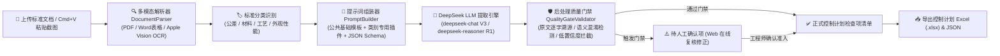

# CP-Extractor | 标准→控制计划检查项智能提取系统

**CP-Extractor** 是一套面向汽车行业质量工程师（IATF 16949）的智能辅助系统。系统通过 **“公共基础模板 + 四类专用插件 + 双层质量门禁校验 + 人工确认复核工作台”** 架构，将繁杂的技术标准（PDF、扫描件、Word、Markdown 或直接粘贴的标准截图）自动转化为结构化、可溯源、零编造的**控制计划（Control Plan）检查项清单**，并支持一键导出标准格式 Excel 报表。

---

## ✨ 核心特性

1. **📄 多格式解析与截图一键粘贴 (OCR)**
   - 支持直接上传 `.pdf`（含原生文本层及扫描件图片型 PDF）、`.docx`（自动保留并转换 Word 表格结构）、`.md`、`.txt`。
   - 支持在网页端直接按 **`Cmd+V` / `Ctrl+V` 粘贴剪贴板截图**（或上传 `.png/.jpg/.webp`），内置 **macOS Apple Vision 高精度中英混合 OCR**（自动按行对齐公差/成分表格）及 Tesseract 跨平台回退机制。
2. **🧩 模块化分类插件架构**
   - 内置四大标准领域专用提取插件：
     - 📐 **公差/尺寸标准插件**（`tolerance`）：聚焦线性公差、GD&T 形位公差、未注公差跨页表格对齐。
     - 🧪 **材料标准插件**（`material`）：聚焦化学成分、拉伸/屈服/延伸率、硬度及金相，严格区分“试验方法”与“合格判据”。
     - 🔥 **工艺标准插件**（`process`）：聚焦热处理、焊接、涂装等过程参数窗口，区分“设备要求”与“过程控制参数”。
     - ✨ **外观/性能标准插件**（`appearance_performance`）：聚焦表面缺陷限度、盐雾耐候、附着力及定性转定量判据。
3. **📝 可视化提示词与「待人工确认」规则在线配置**
   - Web 界面内置提示词配置中心，支持在线编辑 `base_template.md` 与四大分类插件，并提供**宽松模式 / 严格模式 / 建议项过滤 / 建议项拦截**快捷规则注入、组装预览与一键恢复出厂默认。
4. **🛡️ 双层质量门禁与反幻觉溯源**
   - **第一层（LLM 语义初判 + 模型强约束）**：对存疑条款标记 `needs_human_review`，且所有低置信度项 100% 强制进入待人工确认清单。
   - **第二层（确定性规则门禁 `QualityGateValidator`）**：自动核验标准条款号缺失、原文引用逐字溯源匹配（防大模型改写或编造）、试验方法与判定准则语义混淆、物理单位完整性。
5. **👨‍🔬 人工审核门禁与 Excel 实时同步**
   - 触发门禁的检查项自动分流至「⚠️ 待人工确认项」页签，质量工程师可在线修订公差规范、检查方法与判定准则，点击**「✔️ 确认准入控制计划」**或**「✖️ 驳回剔除」**后自动刷新并生成多 Sheet 专业配色 Excel 控制计划报表。

---

## 🏗️ 系统工作流架构



---

## 📂 项目目录结构

```text
CP/
├── spec.md                         # 系统规格说明书 (v1.0)
├── pyproject.toml                  # Python 项目依赖与构建配置
├── .env.example                    # 环境变量配置模板
├── start_lan.sh                    # 局域网共享一键启动脚本
├── templates/                      # 提示词模板与插件目录 (支持 Web 在线编辑)
│   ├── base_template.md            # 公共基础提取模板 (全局判定规则)
│   ├── validation_template.md      # 后处理校验模板
│   └── plugins/                    # 四大类专用提取插件
│       ├── tolerance.md            # 公差/尺寸标准插件
│       ├── material.md             # 材料标准插件
│       ├── process.md              # 工艺标准插件
│       └── appearance_performance.md # 外观/性能标准插件
├── scripts/
│   ├── vision_ocr.swift            # macOS 原生 Vision 框架高精度表格对齐 OCR 源码
│   └── run_benchmark.py            # 四类标准样本批量基准测试与产物导出脚本
├── src/
│   └── cp_extractor/
│       ├── api/
│       │   ├── app.py              # FastAPI 后端服务与 REST 接口
│       │   └── static/
│       │       └── index.html      # 可视化提取、提示词配置与人工复核前端工作台
│       ├── core/
│       │   ├── classifier.py       # 标准类别自动分类器
│       │   ├── extractor.py        # 核心提取流水线编排器 (支持 LLM 与离线基准双引擎)
│       │   ├── llm_client.py       # DeepSeek API 客户端 (兼容 V3 / R1 推理模型)
│       │   ├── mapper.py           # 控制计划 Excel (.xlsx) 报表导出映射器
│       │   ├── parser.py           # 多格式文档与截图 OCR 解析引擎
│       │   ├── prompt_builder.py   # 提示词组装、在线读写与默认还原管理器
│       │   └── validator.py        # 质量门禁与反幻觉后处理校验器
│       └── schemas/
│           └── models.py           # Pydantic V2 严格数据契约定义
└── tests/                          # 自动化单元测试与基准回归测试套件
    ├── benchmark_samples/          # 四大类行业标准测试样本 (.md)
    ├── test_api_and_deepseek.py    # FastAPI 接口、人工审核闭环与提示词管理测试
    ├── test_benchmark_regression.py# 四类标准端到端回归测试
    └── test_extractor.py           # 数据模型、校验器与 Excel 导出单元测试
```

---

## 🚀 快速开始

### 1. 环境准备与依赖安装

要求 **Python >= 3.10**（推荐 Python 3.12）：

```bash
# 克隆仓库
git clone https://github.com/jxtanchris/cp-extractor.git
cd cp-extractor

# 创建虚拟环境并安装依赖
python3 -m venv .venv
source .venv/bin/activate
pip install -e ".[dev]"
```

### 2. 配置 DeepSeek API Key

方式一：复制环境变量模板并填入您的 API Key：
```bash
cp .env.example .env
```
编辑 `.env` 文件：
```env
DEEPSEEK_API_KEY=sk-您的真实密钥
DEEPSEEK_BASE_URL=https://api.deepseek.com
DEEPSEEK_MODEL=deepseek-chat
```

方式二：启动 Web 界面后，直接点击页面右上角 **「⚡ DeepSeek API 配置」** 在浏览器中填入保存。

### 3. 启动可视化 Web 工作台

- **局域网共享启动（推荐，本机与同一 Wi-Fi 下的同事均可直接访问）**：
  ```bash
  ./start_lan.sh
  ```
- **仅本机启动**：
  ```bash
  uvicorn src.cp_extractor.api.app:app --host 127.0.0.1 --port 8000 --reload
  ```

启动后打开浏览器访问：
- Web 工作台：**`http://localhost:8000`**
- Swagger 接口文档：**`http://localhost:8000/docs`**

---

## 🖥️ Web 工作台使用指南

1. **第一步：上传文档或粘贴截图**
   - 点击或拖拽上传 `.pdf`、`.docx`、`.md` 标准文档，或者直接使用截图快捷键截图后在页面按 **`Cmd+V` / `Ctrl+V`** 粘贴。
2. **第二步：选择标准所属类别 & 调整提示词规则**
   - 选择文档对应的标准类别（公差/尺寸、材料、工艺、外观/性能）。
   - 如需调整「待人工确认」的判定松紧度，点击顶部或第二步旁的 **「⚙️ 调整提示词/确认规则」**，可一键注入宽松/严格规则并实时保存生效。
3. **第三步：提取、人工门禁复核与导出**
   - 点击 **「🚀 开始提取检查项」**。
   - 在右侧查看「✅ 控制计划检查项清单」与「⚠️ 待人工确认项」，对拦截项在线确认准入或驳回后，点击右上角 **「📥 导出控制计划 Excel (.xlsx)」**。

---

## 🧪 运行测试与基准验证

```bash
# 运行全部单元测试与回归测试
pytest -v

# 运行四大类标准基准测试并生成 Excel/JSON 样例至 output/ 目录
python scripts/run_benchmark.py
```
